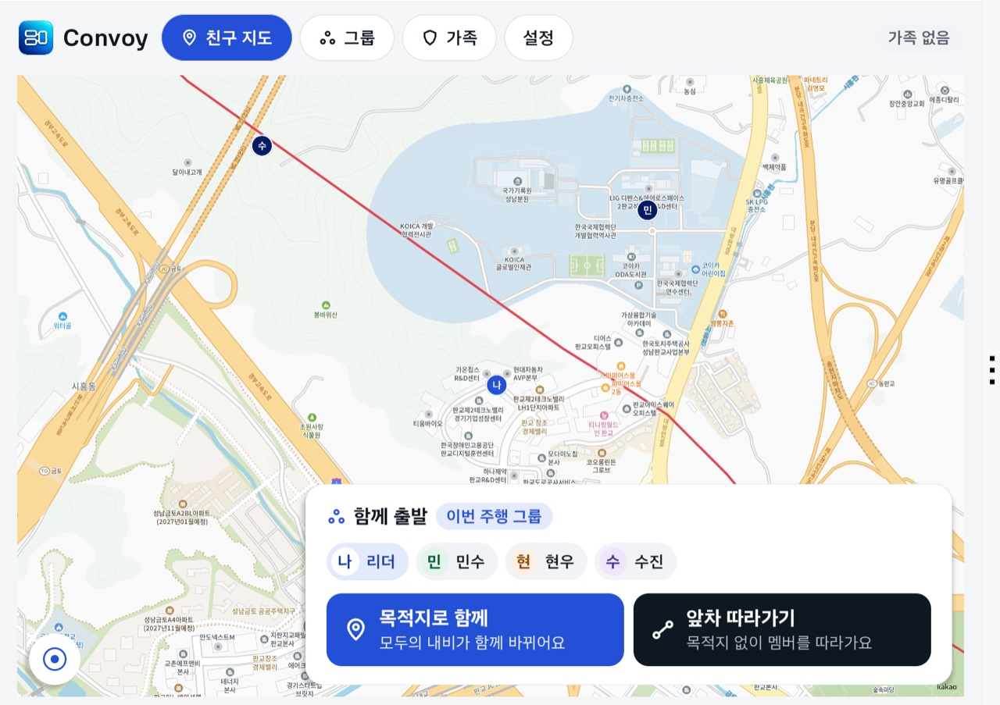
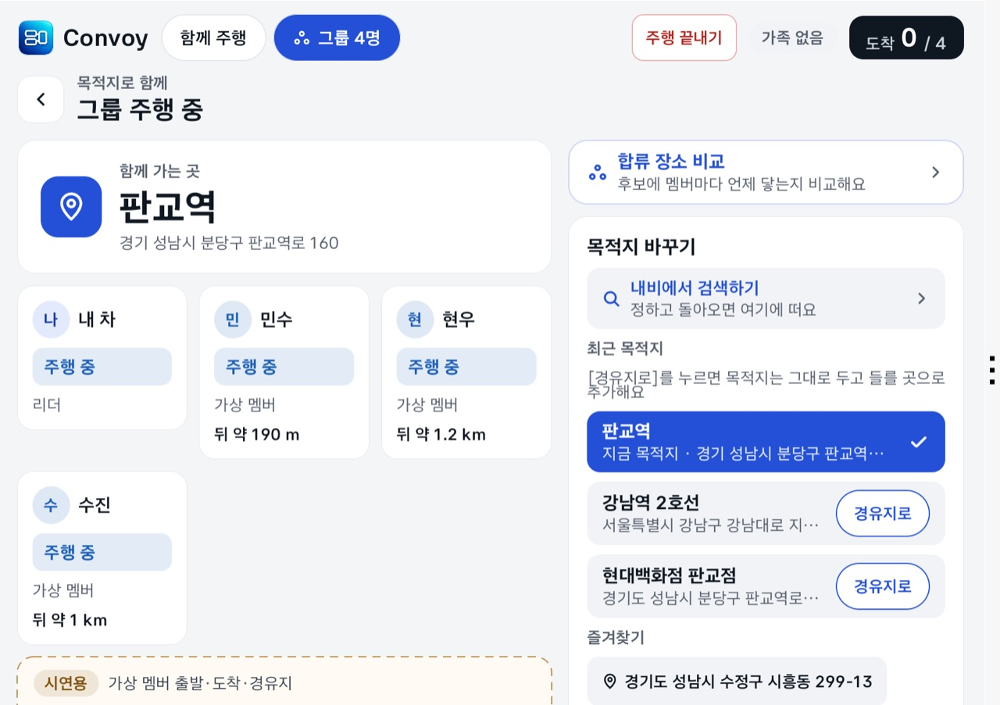
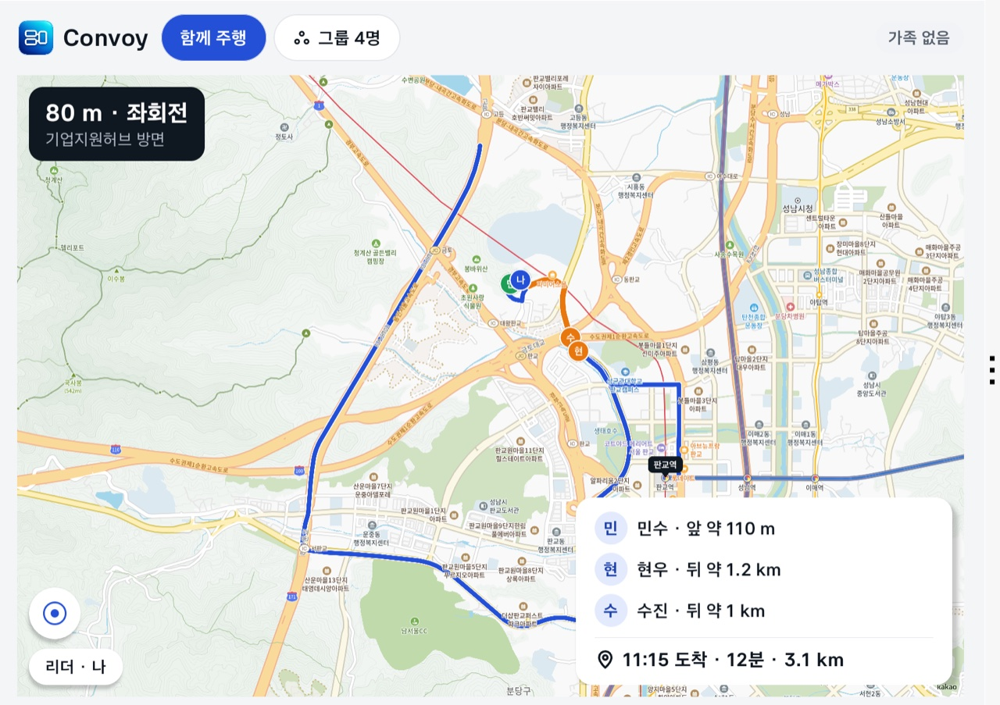
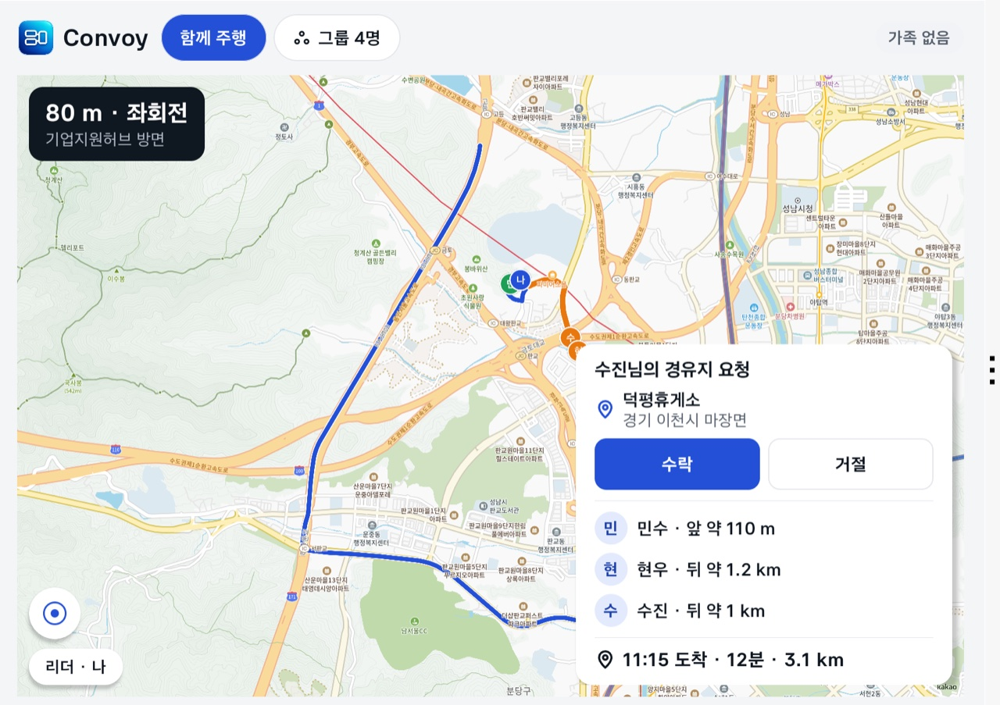
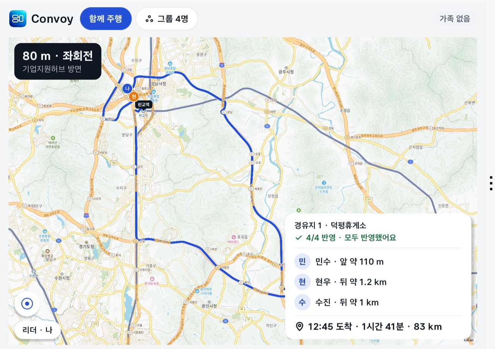
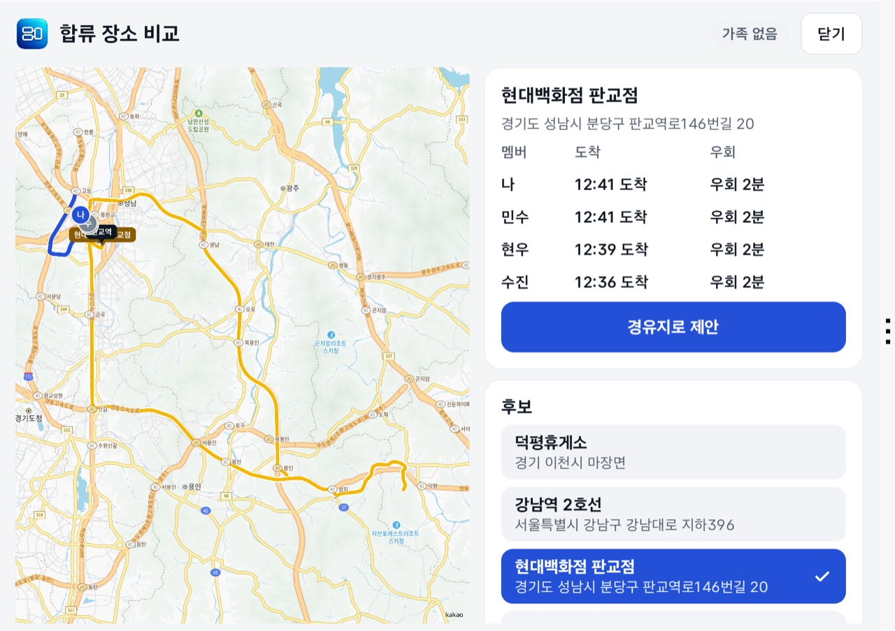
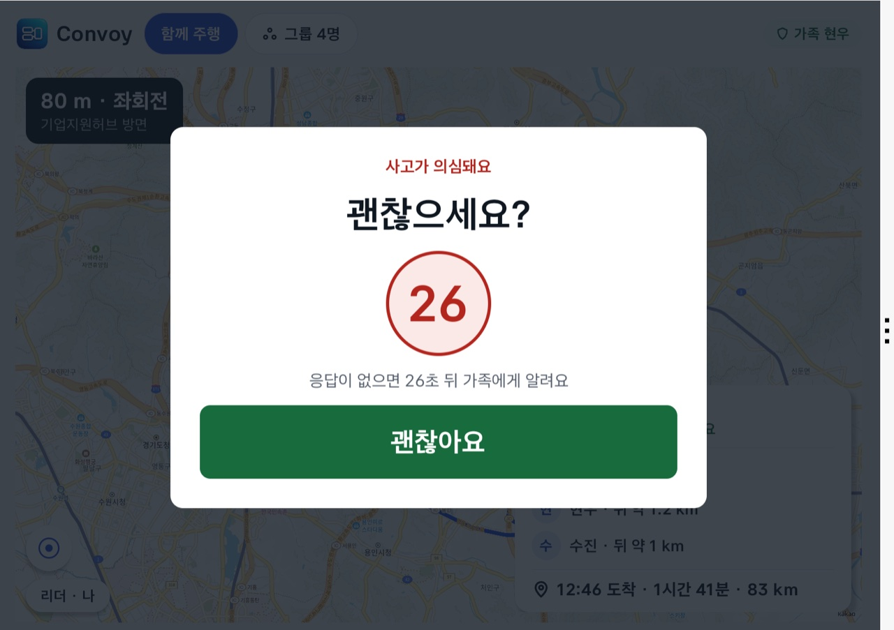
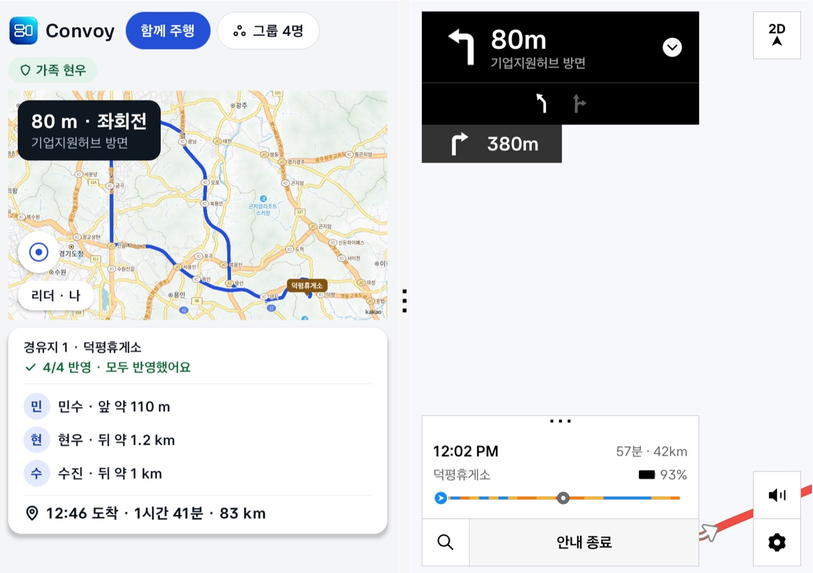

# Convoy

**친구·가족 차량을 서로 동의해 연결하고, 함께 이동할 때는 목적지를, 평소에는 안전을 나누는 차량용 그룹 내비게이션** (Pleos Connect 앱)

- **친구 지도**: 앱은 [친구 지도] [그룹] [가족] [설정] 탭으로 시작합니다. 친구 지도에는 나와 친구 위치가 찍히고(그룹 멤버는 남색), 아래 "함께 출발" 카드에서 바로 출발합니다.
- **목적지로 함께**: 리더가 목적지를 바꾸면 그룹 모든 차의 현대차 내비가 함께 경로를 다시 잡습니다. 현대차 내비에서 검색해 정한 목적지를 그대로 그룹과 공유할 수 있습니다.
- **함께 주행 지도**: 앱 안 카카오맵에 그룹 경로를 그리고, 멤버가 내 경로에서 앞(초록)·뒤(주황) 얼마나 떨어졌는지 경로를 따라 잰 거리로 보여 줍니다. 회전 안내와 도착 예정도 함께 보입니다.
- **경유지 제안**: 멤버가 들를 곳을 제안하면 리더가 승인하고, 모든 차의 내비에 경유지가 들어갑니다. 차마다 반영됐는지("반영 2/3")를 따로 보여 줍니다.
- **합류 장소 비교**: 후보 한 곳을 고르면 멤버마다 언제 닿는지와 우회 시간을 비교하고, 바로 경유지로 제안합니다(자동 추천은 하지 않습니다).
- **앞차 따라가기**: 목적지 없이 멤버 차를 따라갑니다. 앞차가 200m 이상 움직이면 내 내비가 경로를 다시 잡습니다.
- **도착·출발 공유**: 기어(P/D)와 내비 도착 이벤트로 멤버의 출발·도착을 공유합니다.
- **가족 안심**: 에어백·긴급호출 경고등이 켜지면 운전자에게 먼저 "괜찮으세요?"를 묻고, 30초 동안 응답이 없으면 가족에게 위치와 경고등을 알립니다.
- **주행 중 조작 제한**: 설정은 정차(P) 중에만 하고, 주행 중에는 꼭 필요한 조작만 허용합니다.

## 화면
Pleos Connect 에뮬레이터(macOS, ARM)에서 카카오 키를 넣은 debug 빌드로 찍었습니다. 다른 멤버는 시연용 가상 데이터이고, 경로와 시간은 실제 카카오모빌리티 길찾기 결과입니다.

| 친구 지도 | 그룹 주행 |
|---|---|
|  |  |
| **함께 주행 지도** | **경유지 제안** |
|  |  |
| **경유지 반영** | **합류 장소 비교** |
|  |  |
| **사고 의심 확인** | **현대차 내비와 화면 나누기** |
|  |  |

## 실행 방법

### 준비
- Android Studio(최신 안정판)와 JDK 17 이상. 개발은 JDK 24로 했습니다.
- Gradle Wrapper 9.4.1, Android Gradle Plugin 9.2.1, Kotlin 2.2.10, Jetpack Compose(BOM 2025.09.00)
- Pleos SDK는 `settings.gradle.kts`에 등록된 저장소(`https://nexus-playground.pleos.ai/repository/maven-releases/`)에서 받습니다. 별도 키는 필요 없습니다.
- 지도와 길찾기는 카카오맵 SDK와 카카오모빌리티 길찾기 API를 씁니다. 키는 저장소에 넣지 않고 `local.properties`에 적습니다. 키가 없으면 지도 자리에 "지도를 쓰려면 카카오 키가 필요해요"가 나오고, 지도 밖 기능은 그대로 동작합니다.
  ```properties
  KAKAO_NATIVE_APP_KEY=<카카오 네이티브 앱 키>
  KAKAO_REST_API_KEY=<카카오 REST API 키>
  ```
  키를 넣고 빌드하면 REST 키가 APK 안에 들어갑니다. 앱이 길찾기를 직접 부르는 것은 시연용이고, 실서비스에서는 서버가 부릅니다. 그래서 제출용 APK에는 키를 넣지 않았습니다.

### 빌드와 설치
```bash
# JDK 경로는 환경에 맞게 바꿉니다.
export JAVA_HOME=/Library/Java/JavaVirtualMachines/jdk-24.jdk/Contents/Home

./gradlew :app:assembleDebug                      # 빌드
adb -s emulator-5554 install -r app/build/outputs/apk/debug/app-debug.apk
adb -s emulator-5554 shell am start -n com.car.convoy/.MainActivity
```

### 단위 테스트
```bash
./gradlew :app:testDebugUnitTest
```
규칙(그룹 상태, 목적지 동기화, 재탐색 기준, 사고 의심 판단, 주행 중 조작 제한 등)은 SDK와 분리된 순수 함수이고 단위 테스트로 확인합니다. 명세는 [`SPEC.md`](SPEC.md)에 있습니다.

## 테스트 환경 및 필요한 설정

### 에뮬레이터
- Android Studio의 Device Manager에서 Pleos Connect 에뮬레이터 AVD(`Pleos_Connect_v2.1.0`)를 만듭니다.
- **Cold boot**로 실행합니다. Quick boot로 켜면 차량 신호(VHAL)를 쓸 수 없습니다. RAM은 4GB 이상을 권장합니다.

### Virtual Console (기어·경고등 조작)
```bash
adb -s emulator-5554 forward tcp:8088 tcp:8088
# 브라우저에서 http://127.0.0.1:8088/ 을 엽니다. 페이지를 연 뒤에야 콘솔이 차량 신호를 보냅니다.
```
- **기어**: Emulation Controls에서 P/D를 바꿉니다. P → D이면 출발로 보고, D에서는 설정이 잠깁니다.
- **경고등**: Airbag을 On으로 바꾸면 사고 의심 확인("괜찮으세요?")이 시작됩니다.

### 앱 설정과 퍼미션
- 퍼미션: `NAVI_ROUTE`, `NAVI_ROUTE_SEARCH`(경로 요청·취소), `CAR_DRIVE`(기어), `CAR_SAFETY`, `PRIVATE_CAR_SAFETY`(경고등). 에뮬레이터에서는 자동으로 허용됩니다. 실제 차량에서는 `PRIVATE_CAR_SAFETY` 승인이 필요할 수 있습니다.
- 주행 중에도 화면이 보이도록 `distractionOptimized`를 선언했습니다.
- [내비에서 검색하기]는 현대차 내비 앱(에뮬레이터 패키지 `ai.umos.maps.android.navigation.app`)을 띄웁니다. 그래서 매니페스트 `<queries>`에 이 패키지를 적었습니다.
- 사용 SDK: NaviHelper 3.0.5, Vehicle 2.3.2, 카카오맵 SDK 2.15.2(`com.kakao.maps.open:android`)
- 카카오맵 SDK에는 `arm64-v8a`·`armeabi-v7a` 라이브러리만 있어, **Windows용 Pleos 에뮬레이터(x86_64)에서는 지도가 그려지지 않고** 지도 자리에 "이 기기에서는 지도를 그릴 수 없어요"가 나옵니다. 지도 밖 기능(탭, 그룹, 경유지, 합류 비교 표 등)은 그대로 동작합니다.

### 시연용 가상 데이터
서버가 없어서 친구(민수·현우·수진·지영·서준)와 그들의 응답·출발·도착·위치는 앱 안의 가상 데이터입니다. 화면의 점선 **"시연용"** 패널에서 수락·거절, 출발·도착, 앞차 이동, 경유지 제안·반영 실패, 멤버 300m 이동을 만듭니다. 내 차의 내비 경로 요청·취소·경유지 추가, 기어, 경고등, 위치는 실제 SDK로 동작하고, 그룹 경로와 합류 비교의 시간은 실제 카카오모빌리티 길찾기 결과입니다.

녹화나 자동 시연에는 adb 명령도 쓸 수 있습니다(명령 사이에 2초 이상 간격을 둡니다).
```bash
adb -s emulator-5554 shell am start -n com.car.convoy/.MainActivity --es demo <명령>
# 탭:    tab:map, tab:group, tab:family, tab:settings
# 홈:    invite:p1, accept, decline, start, disband, status:busy, family:p1, faccept, fdecline, frelease
# 주행:  dest:서울역, depart:p1, arrive:p1, retry, home, resume, end
# 지도:  mapmove:p1(경로를 따라 300m 앞으로), mapfreeze:p3(위치 갱신 멈춤), maplog
# 경유지: wpropose:p3(가상 멤버 제안), wpropose:me,pangyo(내가 제안), wapprove, wreject, wcancel, wfail:p3, wresend
# 합류 비교: meetopen, meet:<후보 이름>, meetpropose, meetclose
# 따라가기: lead:p1, laccept, ldecline, move:100, unfollow
# 사고:  airbag:on, airbag:off, ok
```

## 개발에 사용한 에뮬레이터와 화면 규격
| 항목 | 값 |
|---|---|
| 에뮬레이터 | Pleos Connect Emulator 2.1.0 |
| 시스템 이미지 | Android 14 (API 34) |
| 화면 | 2560 × 1440 가로, 160dpi (1dp = 1px) |
| 앱 영역 | 앱 하나일 때 가로 약 1,700dp. 화면을 나누면(1:1, 2:1) 좁은 창이 됩니다 |
| 좁은 창 | 앱 영역 가로가 1,200dp 미만이면 1열로 쌓고 손으로 스크롤합니다 |
| 앱 SDK 수준 | minSdk 28, targetSdk 36 |

## APK
- 위치: [`apk/KIN_Convoy_release.apk`](apk/KIN_Convoy_release.apk) (서명된 release 버전, 약 70MB. 카카오맵 SDK 네이티브 라이브러리가 들어 있어 1차보다 큽니다)
  - 탭·지도·경유지·합류 비교까지 들어 있습니다.
  - **카카오 키는 넣지 않고 빌드했습니다.** 그래서 이 APK에서는 지도와 길찾기(함께 주행 지도, 일행 앞뒤 거리, 합류 비교 시간)가 "지도를 쓰려면 카카오 키가 필요해요"로 나오고, 그 밖의 기능은 그대로 동작합니다. 지도까지 보려면 `local.properties`에 키를 넣고 위 "빌드와 설치"대로 직접 빌드합니다.
- 설치: `adb -s emulator-5554 install -r apk/KIN_Convoy_release.apk`
  - debug 빌드가 설치되어 있으면 서명이 달라 설치가 실패합니다. 먼저 `adb -s emulator-5554 uninstall com.car.convoy`를 실행합니다.

## 알려진 한계
- 다른 차는 모두 가상이고, 실제 여러 차를 잇는 서버는 없습니다.
- 에뮬레이터는 내 차 위치가 고정이라, 내 차 도착과 "모두 도착했어요"는 시연하지 못합니다.
- Windows x86_64 에뮬레이터에서는 카카오맵이 그려지지 않아, 지도 위 경로선·마커·카메라는 이 환경에서 확인하지 못했습니다(지도 값을 만드는 규칙은 단위 테스트로 확인).
- 에뮬레이터 내비는 최근 목적지를 하나만 남기고 즐겨찾기가 비어 있어, 그룹 목적지를 정한 뒤에는 합류 비교 후보가 목적지 하나뿐입니다. 시연하려면 내비 즐겨찾기에 장소를 미리 넣어 둡니다.
- 실제 차량에서 확인이 필요한 것: 주행 중 화면 표시(`distractionOptimized`) 허용, 사고 의심 때 화면을 앞으로 가져오기, 현대차 내비 앱 패키지 이름, 도착 판정의 주소 비교. 자세한 내용은 [`docs/sdk-findings.md`](docs/sdk-findings.md)에 있습니다.
